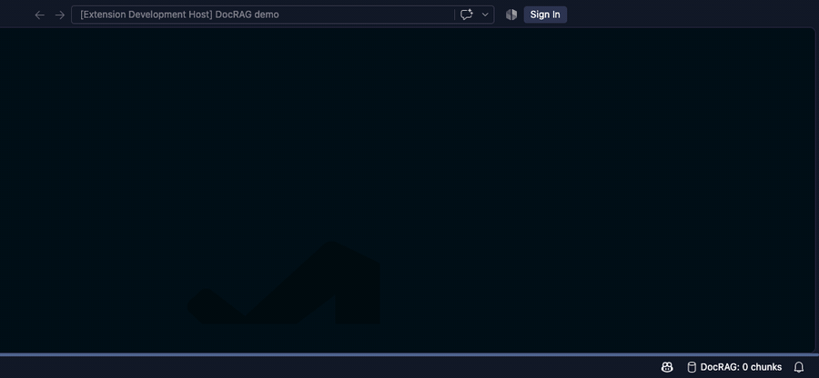
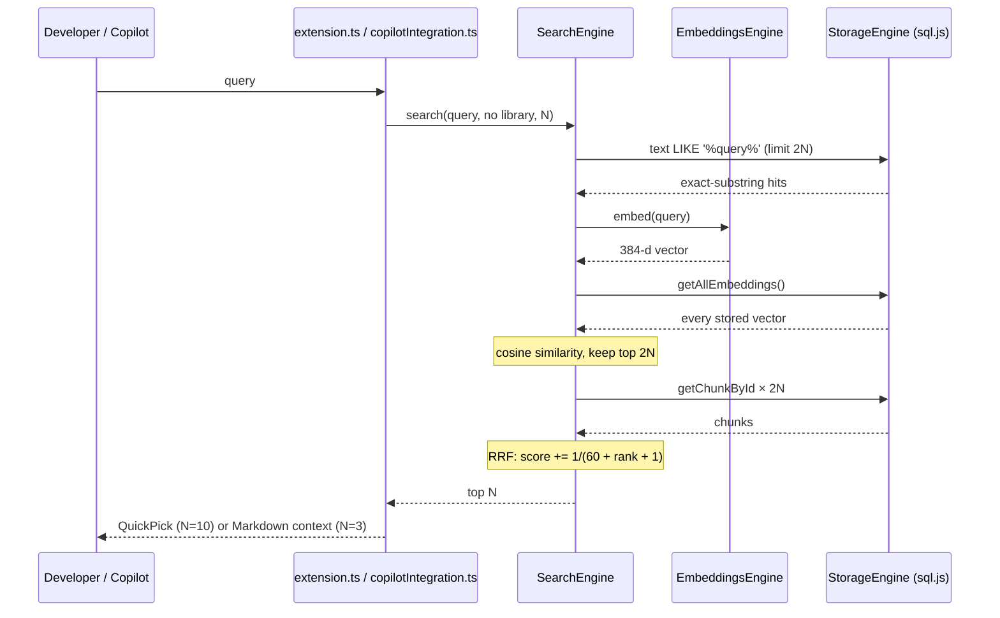

<!-- Cards are generated from docs/assets/cards.json with repo-polish (tools/cards/cards.py). Regenerate after editing it. -->

<picture>
  <source media="(prefers-color-scheme: dark)" srcset="docs/assets/hero-dark.svg"/>
  
</picture>

<p align="center">
  <a href="#-see-it-work"><b>Demo</b></a> &nbsp;·&nbsp;
  <a href="#-how-it-works"><b>Architecture</b></a> &nbsp;·&nbsp;
  <a href="#-run-it"><b>Run it</b></a> &nbsp;·&nbsp;
  <a href="docs/"><b>Docs</b></a> &nbsp;·&nbsp;
  <a href="#-whats-next"><b>What's next</b></a>
</p>

DocRAG is a VS Code extension for giving a coding assistant documentation newer than its training data. Point it at a
library's docs URL. It finds the pages, splits them into chunks, embeds them locally with `all-MiniLM-L6-v2`, and stores
everything in a SQLite file in VS Code's storage. You can then search from the command palette, and Copilot chat can
call it as the `#docrag` tool.

**Why it exists:** AI coding assistants keep suggesting deprecated APIs for fast-moving libraries because their training data is months or years old. DocRAG was built to feed them the current docs instead ([original MVP plan](docs/planning/mvp-product-roadmap.md)).

## ▸ See it work

<p align="center">
  
</p>
<p align="center"><sub>Real run in VS Code 1.145.2 against Vite's 8 config pages (<code>https://vite.dev/config</code>) · indexing is sped up 8× and the search wait 3×</sub></p>

What you can do:

- **Index a library's docs** — `DocRAG: Index Documentation` takes any `{ name, url }` from settings. If the site has a
  `sitemap.xml`, only pages under that URL are indexed; otherwise links are crawled up to 3 levels deep.
- **Search them** — `DocRAG: Search Documentation` runs keyword and vector search, fuses the rankings, and opens the
  page you pick.
- **Give Copilot current docs** — the `docrag-search` language-model tool (`#docrag` in chat) returns the top 3 chunks
  with their source URLs.
- **Keep it local** — no API key. Network traffic is limited to fetching the docs pages and a one-time ~23 MB model
  download.

## ▸ How it works

<picture>
  <source media="(prefers-color-scheme: dark)" srcset="docs/assets/architecture-dark.svg"/>
  
</picture>

<picture>
  <source media="(prefers-color-scheme: dark)" srcset="docs/assets/flow-dark.svg"/>
  
</picture>

<picture>
  <source media="(prefers-color-scheme: dark)" srcset="docs/assets/decisions-dark.svg"/>
  
</picture>

<picture>
  <source media="(prefers-color-scheme: dark)" srcset="docs/assets/editor-dark.svg"/>
  
</picture>

<details>
<summary><b>Search request sequence (detailed)</b></summary>



More in [docs/architecture.md](docs/architecture.md), including an interactive version of this diagram and the indexing
sequence.

</details>

## ▸ Built with

<picture>
  <source media="(prefers-color-scheme: dark)" srcset="docs/assets/stack-dark.svg"/>
  
</picture>

## ▸ Run it

You need Node.js and npm to build (tested with Node 24.16.0 and npm 11.13.0) and VS Code **1.95 or newer** to run it
(tested with 1.145.2). GitHub Copilot Chat is optional and only needed for the `#docrag` tool.

<picture>
  <source media="(prefers-color-scheme: dark)" srcset="docs/assets/terminal-dark.svg"/>
  
</picture>

**Build**

```bash
git clone https://github.com/Aryan-yadav15/DocAiAssist.git
cd DocAiAssist
npm ci
npm run compile
```

**Run:** open the folder in VS Code and press **F5** (**Run Extension**). In the Extension Development Host window, add
a library to your user `settings.json`:

```json
{
  "docrag.libraries": [
    { "name": "Vite", "url": "https://vite.dev/config" }
  ]
}
```

Then run **DocRAG: Index Documentation** → **Vite**, and **DocRAG: Search Documentation**. Settings, data locations and
troubleshooting are in [docs/setup.md](docs/setup.md).

<details>
<summary><b>Project structure</b></summary>

```
src/
  extension.ts                       activation, commands, indexing pipeline, status bar
  types.ts                           shared interfaces
  discovery/discoveryEngine.ts       sitemap.xml + fallback crawler
  scraper/scraperEngine.ts           fetch + cheerio text extraction
  chunking/chunkingEngine.ts         chunking with overlap
  embeddings/embeddingsEngine.ts     Transformers.js MiniLM embeddings
  storage/storageEngine.ts           sql.js SQLite: chunks, embeddings, libraries
  search/searchEngine.ts             keyword + vector search, RRF
  integration/copilotIntegration.ts  docrag-search language-model tool
docs/                                architecture, codebase, setup, api, data, testing, ADRs, planning
```

</details>

## ▸ What's next

- **Real keyword search.** The keyword half is one SQL `LIKE '%query%'`, so multi-word questions rely entirely on vectors.
  The BM25/TF-IDF the original plan describes isn't implemented (a `natural` index is built but never queried). SQLite FTS5
  or querying that TF-IDF index would fix it.
- **Keep page structure when scraping.** The scraper collapses all whitespace, so headings and paragraphs are lost before
  chunking. Chunks are now cut at sentence boundaries instead (fixed in this pass), but splitting on headings would give
  better chunks.
- **Wire up two settings.** `docrag.embeddingModel` and `docrag.maxSearchResults` are read but ignored, and
  `docrag.enableCopilotIntegration` only toggles a "proactive" search that logs and does nothing else.
- **Tests and lint.** `npm test` and `npm run lint` are defined, but there are no tests and no ESLint config. The engines
  are plain Node classes and easy to unit-test ([docs/testing.md](docs/testing.md)).
- **Scale.** Pages are fetched and embedded one at a time, vector search scans every stored vector (parsed from JSON on
  each query), and sql.js keeps the whole database in memory. Fine for a few thousand chunks; it needs batching and a
  vector index beyond that.
- **Polite crawling.** No rate limiting, no `robots.txt` handling, no page cap beyond depth 3 × 50 links, and sitemap
  index files aren't followed.
- **Copilot tool verified end to end.** The tool now registers correctly, but calling it from a signed-in Copilot session
  hasn't been tested.
- **Dependency audit.** `npm ci` reports 31 known vulnerabilities in the dependency tree (21 high, 1 critical); they haven't
  been triaged.

<sub>Full documentation: [docs/](docs/): [architecture](docs/architecture.md) · [codebase](docs/codebase.md) · [setup](docs/setup.md) · [commands & Copilot tool](docs/api.md) · [data](docs/data.md)</sub>
