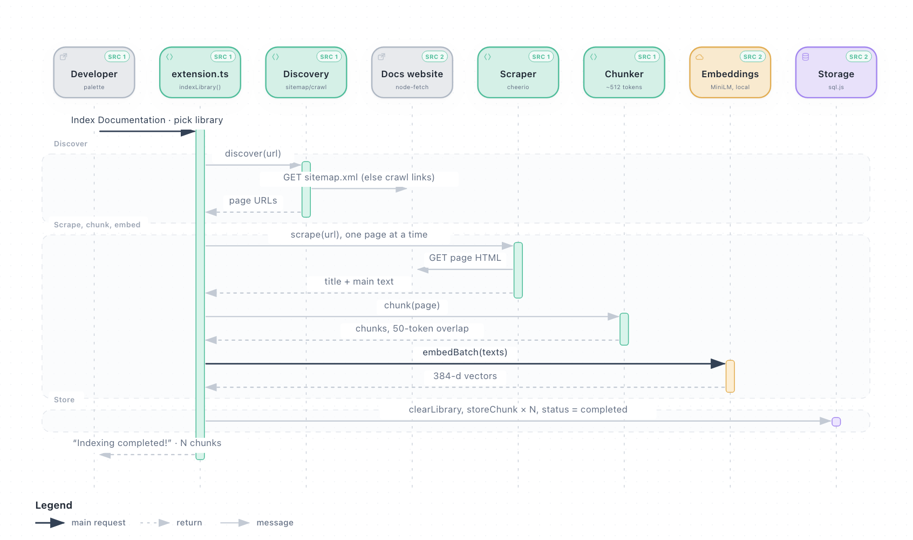
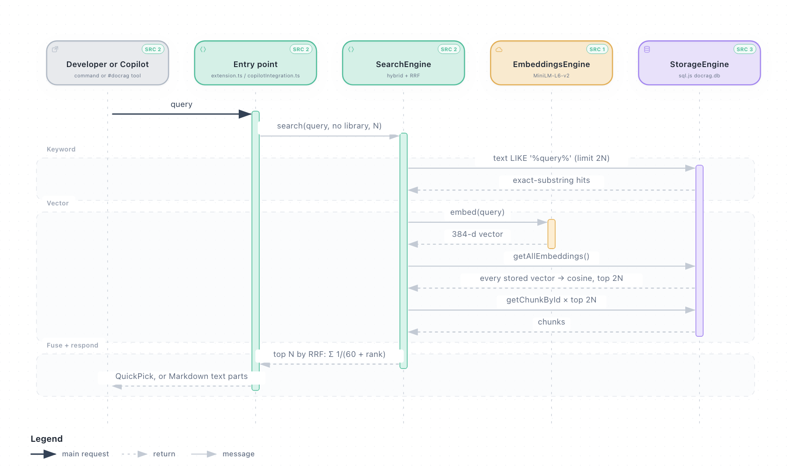

# Architecture

DocRAG is a VS Code extension that runs entirely inside the extension host. It turns a library's documentation
website into a local search index and answers queries from that index, both from a command and as a
language-model tool that Copilot chat can call. Indexing is a linear pipeline of small "engines"
(discover → scrape → chunk → embed → store); search is a hybrid of a SQL substring match and a brute-force
cosine search, merged with reciprocal rank fusion.

## Components

| Component | Responsibility | Code |
|---|---|---|
| Extension entry | activation, the four commands, the indexing pipeline, status bar, settings | [`src/extension.ts`](../src/extension.ts) |
| DiscoveryEngine | find page URLs: `sitemap.xml` first, otherwise a link crawl | [`src/discovery/discoveryEngine.ts`](../src/discovery/discoveryEngine.ts) |
| ScraperEngine | fetch a page and extract title + main text with cheerio | [`src/scraper/scraperEngine.ts`](../src/scraper/scraperEngine.ts) |
| ChunkingEngine | split page text into ~`chunkSize`-token chunks with overlap | [`src/chunking/chunkingEngine.ts`](../src/chunking/chunkingEngine.ts) |
| EmbeddingsEngine | run `Xenova/all-MiniLM-L6-v2` locally via Transformers.js → 384-d vectors | [`src/embeddings/embeddingsEngine.ts`](../src/embeddings/embeddingsEngine.ts) |
| StorageEngine | SQLite (sql.js / WASM) database: chunks, embeddings, library status | [`src/storage/storageEngine.ts`](../src/storage/storageEngine.ts) |
| SearchEngine | keyword + vector search, fused with RRF | [`src/search/searchEngine.ts`](../src/search/searchEngine.ts) |
| CopilotIntegration | registers the `docrag-search` language-model tool | [`src/integration/copilotIntegration.ts`](../src/integration/copilotIntegration.ts) |

## How they communicate

Everything is in-process TypeScript calls inside the VS Code extension host; there is no server. The only network
traffic is HTTP `GET`s to the documentation site (node-fetch, [`discoveryEngine.ts:41`](../src/discovery/discoveryEngine.ts#L41),
[`scraperEngine.ts:15`](../src/scraper/scraperEngine.ts#L15)) and the one-time model download from Hugging Face the first
time embeddings run ([`embeddingsEngine.ts:26`](../src/embeddings/embeddingsEngine.ts#L26)). Copilot reaches the extension
through `vscode.lm.registerTool` ([`copilotIntegration.ts:75`](../src/integration/copilotIntegration.ts#L75)).

All work is sequential: one page is fetched at a time and one chunk is embedded at a time.

## Main flow: what happens when you index a library

<picture>
  <source media="(prefers-color-scheme: dark)" srcset="diagrams/indexing-flow-dark.png"/>
  
</picture>

[Interactive version](diagrams/indexing-flow.html) — download and open in a browser to see source links.

1. **Pick a library.** `DocRAG: Index Documentation` offers the configured `docrag.libraries` (or "All Libraries") —
   [`extension.ts:85`](../src/extension.ts#L85).
2. **Discover.** Fetch `<url>/sitemap.xml`, then `<origin>/sitemap.xml`; keep `<loc>` entries that start with the
   configured URL. If none match, crawl links in `nav`, `main`, `article`, `.docs`, `.documentation`, up to depth 3 and 50
   links per page — [`discoveryEngine.ts:15`](../src/discovery/discoveryEngine.ts#L15).
3. **Scrape.** Drop `script, style, nav, header, footer, .sidebar, .navigation, .ads`; take the first of
   `main, article, .content, …` with over 100 characters, else `body`; skip pages under 50 characters —
   [`scraperEngine.ts:13`](../src/scraper/scraperEngine.ts#L13).
4. **Chunk.** Split on blank lines, then split any paragraph larger than `chunkSize` at sentence boundaries
   (tokens are estimated as characters ÷ 4) and add `chunkOverlap` tokens of overlap —
   [`chunkingEngine.ts:19`](../src/chunking/chunkingEngine.ts#L19).
5. **Embed.** Mean-pooled, normalised MiniLM embeddings; chunks whose embedding failed are dropped —
   [`extension.ts:204`](../src/extension.ts#L204).
6. **Store.** Delete the library's old chunks and embeddings, insert the new ones, set status `completed` —
   [`extension.ts:227`](../src/extension.ts#L227). Any exception sets status `error` and shows an error toast
   ([`extension.ts:242`](../src/extension.ts#L242)).

## Second flow: what happens when you search

<picture>
  <source media="(prefers-color-scheme: dark)" srcset="diagrams/search-flow-dark.png"/>
  
</picture>

[Interactive version](diagrams/search-flow.html) — download and open in a browser to see source links.

1. **Keyword half.** `text LIKE '%query%'`, limit 2N — an exact substring match on the whole query
   ([`storageEngine.ts:188`](../src/storage/storageEngine.ts#L188)).
2. **Vector half.** Embed the query, load every stored vector, compute cosine similarity, keep the top 2N, load those
   chunks by id ([`searchEngine.ts:73`](../src/search/searchEngine.ts#L73)).
3. **Fuse.** Each result adds `1 / (60 + rank + 1)` to its chunk's score; the top N are returned
   ([`searchEngine.ts:116`](../src/search/searchEngine.ts#L116)).
4. **Respond.** The command shows a QuickPick and opens the chosen page in the browser (N = 10); the Copilot tool returns
   title, source URL and chunk text as Markdown (N = 3).

## Key decisions

- **sql.js instead of a native SQLite binding.** No per-Electron native rebuild; the cost is that the whole database lives
  in memory and is rewritten to disk on every save. ([ADR 0001](decisions/0001-sqljs-instead-of-native-sqlite.md))
- **Local embeddings with Transformers.js.** No API key and no document text sent to a provider.
  ([ADR 0002](decisions/0002-local-embeddings.md))
- **Reciprocal rank fusion** because substring hits and cosine scores aren't on comparable scales.
  ([ADR 0003](decisions/0003-reciprocal-rank-fusion.md))
- **Sitemap before crawling**, filtered by URL prefix, so a library is scoped by the URL you configure.
  ([ADR 0004](decisions/0004-sitemap-first-discovery.md))

## Known limits

- **Keyword search is not BM25.** It is a single SQL `LIKE` on the full query string, so multi-word natural-language
  queries rarely match and ranking comes from the vector half. `SearchEngine.buildIndex` builds a `natural` TF-IDF index
  after indexing, but nothing queries it ([`searchEngine.ts:26`](../src/search/searchEngine.ts#L26)).
- **Vector search is brute force.** Every query parses every stored embedding from JSON. Fine for thousands of chunks,
  slow for much more.
- **Library filter is applied after the top-2N cut** ([`searchEngine.ts:97`](../src/search/searchEngine.ts#L97)). No caller
  passes a library today, so this has no effect yet.
- **Sequential network and embedding work**, no rate limiting, no `robots.txt` handling.
- **The scraper flattens all whitespace** ([`scraperEngine.ts:156`](../src/scraper/scraperEngine.ts#L156)), so headings and
  paragraph boundaries are lost before chunking; chunks are split by sentence instead.
- **Two settings are read but unused:** `docrag.embeddingModel` (the engine is always created with the default model,
  [`extension.ts:45`](../src/extension.ts#L45)) and `docrag.maxSearchResults` (callers pass 10 and 3).
- **"Proactive context" only logs.** On editor change, the extension searches for tokens on the current line and logs the
  hit count; nothing is passed to Copilot ([`copilotIntegration.ts:91`](../src/integration/copilotIntegration.ts#L91)).

Corrections to the previous version of this page

The earlier `ARCHITECTURE.md` described a different implementation. Corrected here:

- Storage is **sql.js** (SQLite compiled to WASM), not better-sqlite3 or sqlite-vss; embeddings are **JSON text**, not
  BLOBs; there is **no WAL mode**, and **foreign keys are off** (so `ON DELETE CASCADE` never fires).
- Keyword search is SQL `LIKE`, not BM25/TF-IDF.
- The model download is the quantized ONNX build, about **23 MB**, not ~90 MB.
- Embeddings are computed one at a time in groups of 32, not as true batches.
- Copilot integration is a tool Copilot may call; there is no automatic context injection.
- Performance and storage-size figures were estimates and have been removed. Measured: Vite's 8 config pages →
  41 chunks → 480 KB database.

