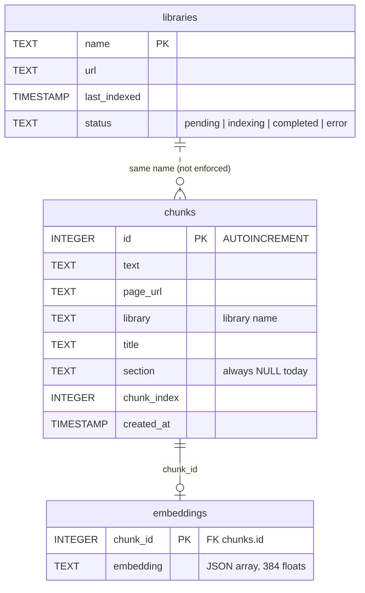

# Data

All state lives in one SQLite database, `docrag.db`, in VS Code's global storage for the extension (path in
[setup.md](setup.md#where-data-lives)). It is opened with **sql.js**, SQLite compiled to WebAssembly: the file is read into
memory on activation, every query runs in memory, and `save()` writes the whole database back with `db.export()`
([`storageEngine.ts:321`](../src/storage/storageEngine.ts#L321)). Saves happen when a chunk id is a multiple of 100,
on every library-status change, on `clearLibrary`, and on deactivate.

The schema is created on every activation with `CREATE TABLE IF NOT EXISTS`
([`storageEngine.ts:61`](../src/storage/storageEngine.ts#L61)); there are no migrations.



## Tables

### `chunks`

One row per text chunk. Written by `storeChunk` ([`storageEngine.ts:98`](../src/storage/storageEngine.ts#L98)).

| Column | Type | Notes |
|---|---|---|
| `id` | INTEGER | PK, `AUTOINCREMENT` — ids are never reused, which keeps embedding lookups unambiguous after re-indexing |
| `text` | TEXT | chunk text; the keyword search runs `LIKE '%query%'` on it |
| `page_url` | TEXT | source page; indexed (`idx_chunks_url`) |
| `library` | TEXT | library name from settings; indexed (`idx_chunks_library`) |
| `title` | TEXT | page title (first `h1`, else `<title>`, …) |
| `section` | TEXT | in the schema but never set by the chunker |
| `chunk_index` | INTEGER | position of the chunk within its page |
| `created_at` | TIMESTAMP | `CURRENT_TIMESTAMP` default |

### `embeddings`

One row per chunk that embedded successfully.

| Column | Type | Notes |
|---|---|---|
| `chunk_id` | INTEGER | PK, declared `REFERENCES chunks(id) ON DELETE CASCADE` |
| `embedding` | TEXT | `JSON.stringify` of the 384-number vector (about 8 KB per row) |

sql.js runs with `PRAGMA foreign_keys` **off**, so the cascade never fires. `clearLibrary` therefore deletes a library's
embeddings explicitly before its chunks ([`storageEngine.ts:262`](../src/storage/storageEngine.ts#L262)). Databases
created by builds before that fix can contain orphaned embeddings: they're skipped when results are loaded, but they can
still take slots among the top-2N vector candidates. Delete `docrag.db` and re-index to remove them.

### `libraries`

Indexing status per configured library, written with `INSERT OR REPLACE` by `updateLibraryStatus`
([`storageEngine.ts:276`](../src/storage/storageEngine.ts#L276)). It is written but never read back; the status bar
counts `chunks` instead.

| Column | Type | Notes |
|---|---|---|
| `name` | TEXT | PK, the library's `name` from settings |
| `url` | TEXT | its configured URL |
| `last_indexed` | TIMESTAMP | `datetime('now')` at every status change, not only on completion |
| `status` | TEXT | `indexing` → `completed` or `error` |

## Sample data

There is no seed data. The demo index (Vite's 8 config pages from `https://vite.dev/config`) produced 41 `chunks`,
41 `embeddings` and one `libraries` row, in a 480 KB file. Per page:

| Page | Chunks |
|---|---|
| Shared Options | 11 |
| Server Options | 10 |
| Build Options | 8 |
| Configuring Vite | 4 |
| Dep Optimization Options | 3 |
| Preview Options | 2 |
| SSR Options | 2 |
| Worker Options | 1 |

To inspect a database from Node:

```bash
node -e "require('sql.js')().then(S=>{const db=new S.Database(require('fs').readFileSync(process.argv[1]));console.log(db.exec('select library, count(*) from chunks group by library')[0])})" /path/to/docrag.db
```
